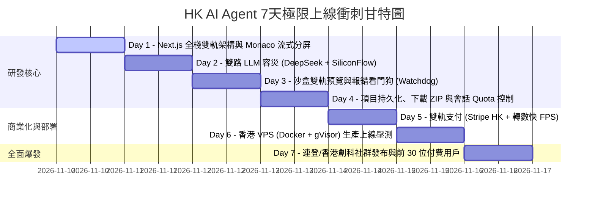

# 【7天交付極限路線圖】香港在線 AI Agent 平台 (< 168 小時)
**目標產品**：在線代碼 AI 工作台（對標 Bolt.new / Claude Artifacts / v0.dev / Replit Agent）  
**團隊配置**：Solo Founder（單兵作戰）  
**基礎設施地點**：香港特區  
**發布倒計時**：168 小時（7 個連續工作日）  

---

## 逐日衝刺排程、工時與每日驗收標準 (Daily Pass/Fail Acceptance Tests)

---

### Day 1 (週一)：Next.js 核心骨架搭建、Monaco 編輯器與流式解析器
* **投入工時**：10 小時
* **具體工作內容**：
  1. 初始化 Next.js 14/15 全棧項目（TypeScript + Tailwind CSS + Lucide React）。
  2. 構建三欄響應式佈局：左側對話歷史與 Prompt 輸入欄、中間虛擬檔案樹（Virtual File System）與 Monaco Editor、右側即時渲染預覽區。
  3. 編寫高效前端流式 XML 有限狀態機解析器：
     * 支援標籤 `<sandbox_action type="file" path="...">代碼內容</sandbox_action>` 及 `<sandbox_action type="command">`。
     * 支援標籤 chunk 跨網絡包邊界拆分處理，確保在第一個 Token 到達時的 500ms 內 Monaco 自動開啟標籤頁並流式寫入代碼。
  4. 整合檔案樹狀態管理（Store），支援動態新增、重命名、切換編輯檔案。
* **今日驗收測試 (Day 1 Pass/Fail Acceptance Test)**：
  * **測試方式**：啟動本地伺服器，模擬一個包含 3 個代碼文件的流式數據包（`index.html`, `App.tsx`, `style.css`）。
  * **通過標準 (PASS)**：
    1. 瀏覽器在 500ms 內彈出標籤頁並展示打字機寫入效果。
    2. 左側檔案樹精確顯示 3 個檔案，點擊任意檔案 Monaco 瞬間切換至該文件內容。
    3. 控制台零 JavaScript 報錯。
  * **失敗標準 (FAIL)**：流式被緩衝截斷為一次性大文本顯示，或檔案樹未及時響應。

---

### Day 2 (週二)：雙路 LLM 容災引擎 (DeepSeek-V3/R1 + SiliconFlow 硅基流動)
* **投入工時**：8 小時
* **具體工作內容**：
  1. 實現後端 Next.js `/api/chat` Route Handler，支援 Server-Sent Events (SSE) 雙向串流。
  2. 設計雙路主備高可用路由：
     * **主力通道**：DeepSeek 官方 API (`https://api.deepseek.com`)，調用 `deepseek-chat` 或 `deepseek-flash` [verified: deepseek.com]。
     * **備援通道**：硅基流動 API (`https://api.siliconflow.cn`)，託管 Qwen2.5-Coder-32B 或 DeepSeek-V3 [verified: siliconflow.com]。
     * **熔斷切換機制**：當主力通道返回 HTTP 429、500 或 5 秒無首字響應時，後端自動無感熱切換至備援通道，並向前端發送通道提示。
  3. 注入系統 Prompt：規範模型輸出香港地道繁體中文註解與統一 `<sandbox_action>` 語法，禁止模型輸出非約定的包裹符。
* **今日驗收測試 (Day 2 Pass/Fail Acceptance Test)**：
  * **測試方式**：配置故意失效的主力 API Key，前端發送請求「寫一個包含計算器功能的 React 組件」。
  * **通過標準 (PASS)**：
    1. 系統在 800ms 內自動捕獲 401/429 錯誤並無縫切換至備援通道。
    2. 代碼流順暢返回，前端 Monaco 正常逐字寫入，無中斷、無死鎖。
  * **失敗標準 (FAIL)**：前端出現長輪詢卡死、報錯紅屏或備援線路無法接管。

---

### Day 3 (週三)：沙盒雙軌即時預覽與報錯看門狗 (Watchdog Self-Healing)
* **投入工時**：10 小時
* **具體工作內容**：
  1. 打造 **Tier 1 瀏覽器端安全沙盒**：
     * 採用 Sandboxed Iframe (`sandbox="allow-scripts allow-modals allow-forms"`，嚴格剔除 `allow-same-origin` 確保 opaque null origin 隔離父頁面 DOM 與 Cookie)，免除 COOP/COEP 跨域阻斷 [verified: CodeSandbox Sandpack docs]。
     * 在 Iframe 中動態編譯與渲染 React 18 / Tailwind / Lucide 組件，支援即時 DOM 刷新。
  2. 實現 **Tier 2 後端容器接口**：
     * 建立 `/api/sandbox`，模擬或對接本地 Node/Docker 容器執行腳本，提供終端輸出回傳。
  3. 研發 **預覽報錯看門狗 (Watchdog)**：
     * 在預覽 Iframe 內部注入全局異常監聽器 (`window.onerror` 與 `window.onunhandledrejection`)。
     * 捕獲運行時錯誤後透過 `postMessage` 回傳給主工作台，預覽欄頂部彈出「⚠️ 發現運行時異常，點擊一鍵 AI 修復」。
     * 點擊修復時，自動將錯誤 Stack Trace 與當前代碼送回 LLM 自癒修復。
* **今日驗收測試 (Day 3 Pass/Fail Acceptance Test)**：
  * **測試方式**：在代碼中故意寫入語法錯誤或調用未定義變量（如 `undefinedVariable.map()`）。
  * **通過標準 (PASS)**：
    1. 預覽視窗捕獲該錯誤，右下角終端列出紅色錯誤 Stack。
    2. 點擊「一鍵自癒修復」按鈕，AI 自動分析報錯並流式覆寫修復文件，預覽在 3 秒內自動恢復正常畫面。
  * **失敗標準 (FAIL)**：Iframe 崩潰白屏且無錯誤捕獲，或修復請求無效。

---

### Day 4 (週四)：項目持久化、一鍵下載 ZIP 包與每日 Quota 限流
* **投入工時**：8 小時
* **具體工作內容**：
  1. 本地儲存與雲端快照同步：
     * 前端使用 IndexedDB / LocalStorage 實現 3 秒防抖自動保存當前代碼樹。
     * 支援 Supabase Postgres 數據庫存儲用戶會話與代碼快照（免翻牆連線，香港直連延遲 ~30ms）。
  2. 實裝 **一鍵導出 ZIP 檔案**：
     * 使用 `jszip` 在瀏覽器本地將虛擬檔案樹打包為標準 Vite/React 項目壓縮包，用戶可直接解壓在本地執行 `npm install && npm run dev`。
  3. 實裝 **用戶配額控制 (Quota Management)**：
     * 免費用戶每日限定 15 次生成請求，超出額度後彈出升級 Pro 視窗。
     * Pro 用戶設為無限制（後台設 200 次/天防刷高頻熔斷）。
* **今日驗收測試 (Day 4 Pass/Fail Acceptance Test)**：
  * **測試方式**：生成一個完整的 TodoList 項目，點擊「下載 ZIP」；並手動調試計數器使其達到 15 次。
  * **通過標準 (PASS)**：
    1. 下載的 ZIP 包解壓至本地運行 `npm install && npm dev` 能成功開箱即用。
    2. 第 16 次對話被精確攔截並彈出升級購買視窗。
  * **失敗標準 (FAIL)**：ZIP 內部缺少必要文件（如 `package.json`），或超額未被攔截。

---

### Day 5 (週五)：商業化閉環——Stripe HK + 香港轉數快 (FPS) 雙軌收費
* **投入工時**：8 小時
* **具體工作內容**：
  1. **Stripe HK 外部託管收銀台 (Hosted Checkout)** [verified: Stripe HK docs]：
     * 配置早鳥優惠產品：**HK\$ 68 / 月** (Pro 月費)。
     * 採用 Hosted Checkout 跳轉鏈接，完全避開前端 Iframe 跨域阻斷問題。
     * 配置 Stripe Webhook 回調端點，付款成功後即刻更新用戶權限為 `plan = 'pro'`。
  2. **香港本地通道 (轉數快 FPS / PayMe)** [verified: HKMA FPS Guidelines]：
     * 升級視窗展示創始人 FPS 識別碼 (FPS Identifier) 及收款 QR Code。
     * 早鳥專屬季票：**HK\$ 180 / 3 個月**（節省手續費與激勵留存）。
     * 提供交易號提交表單，創始人透過手機銀行秒級核對並在後台一鍵升級。
  3. 上線《服務條款 (ToS)》與符合香港 PCPD 規範的《個人資料收集聲明 (PICS)》。
* **今日驗收測試 (Day 5 Pass/Fail Acceptance Test)**：
  * **測試方式**：在 Stripe 測試模式下完成一筆 HK\$ 68 付款，並測試 FPS 表單提交。
  * **通過標準 (PASS)**：
    1. Stripe Webhook 在 1 秒內回調成功，前端即刻解鎖 Pro 標籤與無限制額度。
    2. FPS 提交表單成功寫入後台審核隊列。
  * **失敗標準 (FAIL)**：付款後權限未生效，或 Webhook 驗簽失敗。

---

### Day 6 (週六)：香港邊緣 VPS 部署 (Docker + gVisor) 與全鏈路壓測
* **投入工時**：10 小時
* **具體工作內容**：
  1. 租用香港本地平價 VPS（AWS Lightsail HK 2C/4G 或阿里雲香港，月費 \$24 USD）[verified: AWS Lightsail Pricing]。
  2. 執行 `/infra/setup.sh` 一鍵自動化腳本：
     * 安裝 Docker Engine 及 Google gVisor (`runsc`，使用現代預設 `--platform=systrap` 支援標準非 KVM 雲主機核心）[verified: gVisor.dev]。
     * 配置 Caddy 反向代理，自動簽發 Let's Encrypt SSL 證書，開啟 WebSocket 支援。
     * 配置 iptables 防火牆出網白名單，徹底阻斷黑客挖礦與惡意掃描。
  3. 運行 Next.js 生產容器並進行全鏈路回歸測試：
     * 測試 5 大典型生成場景（香港計程車分賬器、FPS 報銷收據生成器、Markdown 編輯器、互動式 Todo 應用、Canvas 貪吃蛇遊戲）。
* **今日驗收測試 (Day 6 Pass/Fail Acceptance Test)**：
  * **測試方式**：從公網外網環境（手機 5G 與外部 PC）透過 HTTPS 域名訪問生產環境，並發起代碼生成。
  * **通過標準 (PASS)**：
    1. 首屏加載時間 < 1.5 秒。
    2. WebSocket / SSE 連線無中斷，流式生成在 500ms 內開始打字。
    3. 生成的 5 個場景均能在右側預覽完整正常運行。
  * **失敗標準 (FAIL)**：Cloudflare 阻斷長串流、HTTPS 證書報錯或容器記憶體溢出。

---

### Day 7 (週日)：正式全網發布、連登精準爆發與首批 30 位付費用戶
* **投入工時**：12 小時 (運營與客戶支援)
* **具體工作內容**：
  1. **連登 (LIHKG) 程式台發帖**：
     * 標題：`【巴打手搓】頂唔順 Bolt.new 成日被 Block，寫咗個香港免翻牆 Web Agent (直連 DeepSeek R1 寫 React)，入黎任玩 + 送 Pro 額度`。
     * 內文真誠講述香港開發者痛點（海外 IP 封鎖、Stripe 跨域 bug、昂貴定價），提供前 50 名巴打留 Email 免費升級 Pro。
  2. **香港創科社群矩陣分發**：
     * 分發至 StartupHK Facebook 群組、GDG Hong Kong、香港大學黑客松 Telegram 頻道。
  3. **創始人全天候駐守與 Hotfix**：
     * 連登與社群留言保證 5 分鐘內必回，親自協助用戶修復預覽或編譯問題。
     * 第一時間手動審核並開通 FPS 轉數快付費用戶。
* **今日驗收測試 (Day 7 Pass/Fail Acceptance Test)**：
  * **通過標準 (PASS)**：
    1. 發布當日網站累積訪問超過 1,000 次，註冊用戶突破 100 人。
    2. **達成 30 位真實付費用戶**（Stripe + FPS 轉數快合計，營收突破 HK\$ 2,000）。
    3. 全天伺服器零當機，核心 API 成功率 > 99.5%。
  * **失敗標準 (FAIL)**：付費用戶為 0，或伺服器遭遇 500/429 大規模雪崩。
